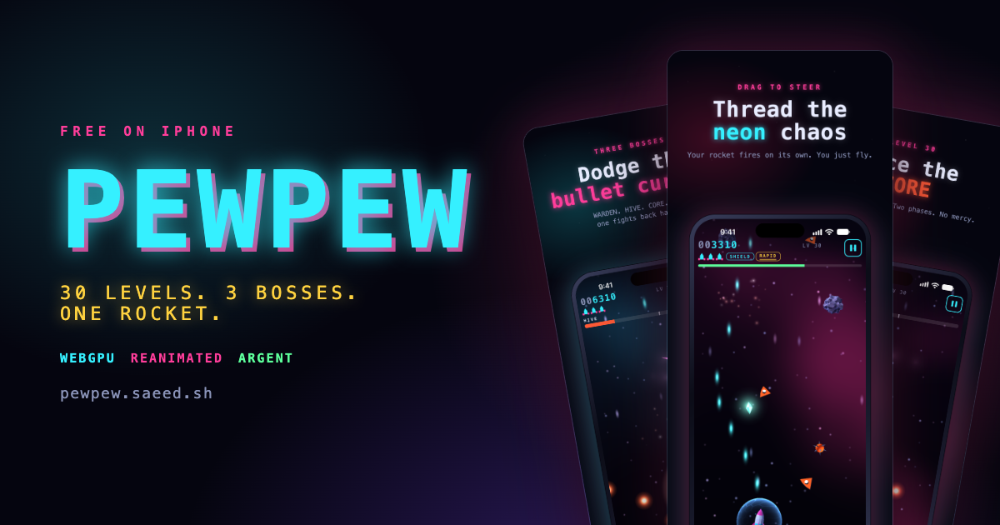
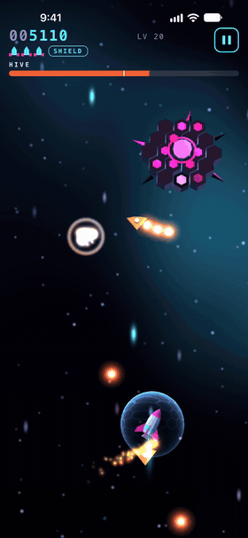
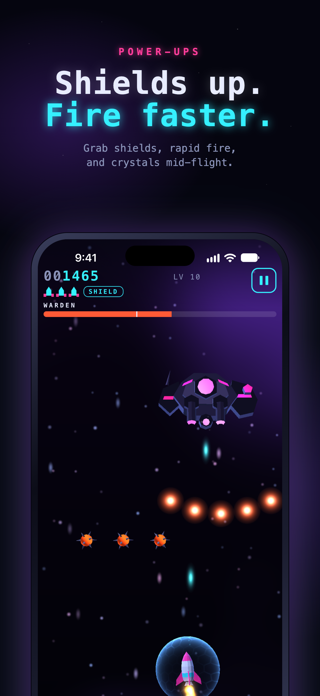
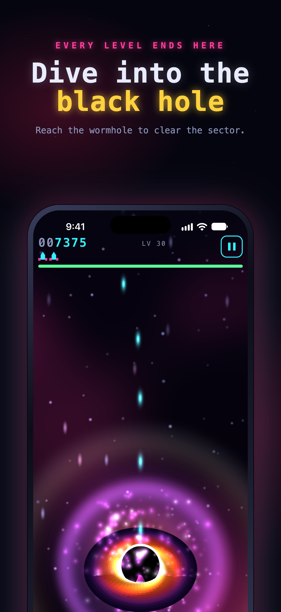
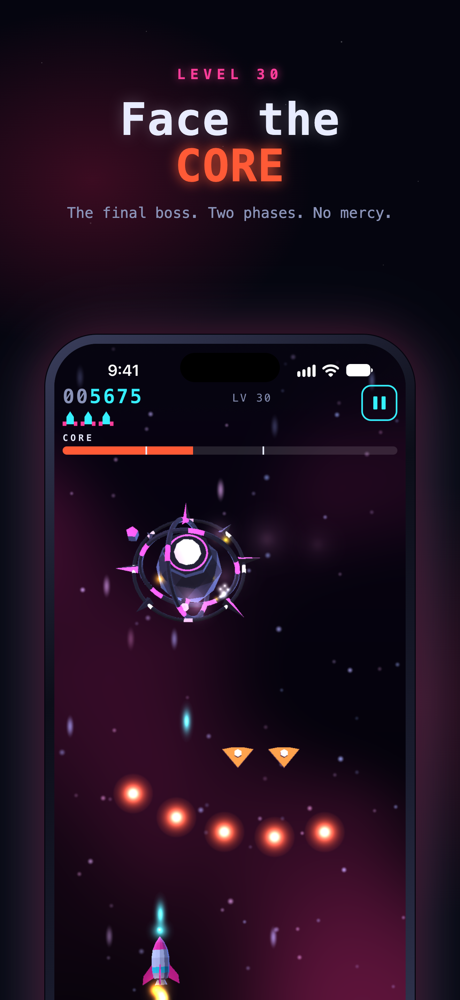

<p align="center">
  <a href="https://pewpew.saeed.sh"></a>
</p>

<p align="center">
  <a href="https://apps.apple.com/app/id6822155755"></a>
</p>

<p align="center">
  <a href="https://pewpew.saeed.sh"><b>Play it in your browser</b></a> ·
  <a href="https://github.com/Stringsaeed/pewpew/actions/workflows/check.yml"></a> ·
  <a href="LICENSE">MIT</a>
</p>

PewPew is a neon space shooter for iPhone. Thread a rocket through asteroid fields, minefields, drone swarms, and gravity wells, beat a boss every tenth level, and dive into the black hole.

It's a React Native app with no game engine. Every frame is drawn by **WebGPU**, the UI animates on **Reanimated 4**, and the music is synthesized live by **React Native Audio API**. AI agents wrote the code, then play-tested and profiled it on the iOS Simulator through **Argent**.

<table>
  <tr>
    <td width="34%"></td>
    <td></td>
    <td></td>
    <td></td>
  </tr>
</table>

## The game

- **30 levels** in three tiers, each with its own palette and song. Every difficulty column ramps up and never goes down.
- **3 bosses.** The Warden, the Hive, and the Core each have 2 to 3 phases with their own attack cycles.
- **One finger.** Drag anywhere to steer and the rocket fires on its own. The lives you finish with are your stars.
- **Free, offline, private.** No account, ads, tracking, or in-app purchases. Progress stays on the device.

## How it's built

| Layer | What it does |
| --- | --- |
| [react-native-webgpu](https://github.com/wcandillon/react-native-webgpu) | Four WGSL pipelines: a procedural nebula and starfield, instanced flat-shaded meshes, additive glow, and a fresnel shield bubble. Instance data goes up in three buffer writes per frame. |
| [Reanimated 4](https://docs.swmansion.com/react-native-reanimated/) | Score pops, lost lives, boss bars, and panels run on the UI thread. React renders the HUD only when a value on it changes. |
| [React Native Audio API](https://docs.swmansion.com/react-native-audio-api/) | Tracker songs and effects synthesized at runtime from data. The app ships zero audio files. |
| [Argent](https://github.com/software-mansion/argent) | Agents drove the simulator: they tapped, swiped, read the React tree, profiled, and recorded. They also staged every screenshot and video in the launch kit. |
| Pure TypeScript sim | Fixed 60 Hz step, seeded tracks, and no platform code. It runs the same on the phone, in Node, and in a browser. |

The whole JS frame (sim, bot, renderer, audio, and HUD) takes about 3 ms and held 60 fps in a simulator dev build ([report](.audit/u7-report.md)). Meshes are generated by a script, so the app bundles no image, model, or audio assets for gameplay.

[`docs/architecture.md`](docs/architecture.md) walks through the design: the compiled track, the flat body pool, the loop, the renderer, and the audio engine.

### Layout

```
src/sim/       deterministic simulation: world, step, boss, drones, input, HUD
src/levels.ts  the 30-row level table, validated at import
src/bot.ts     greedyBot, used by AUTO mode and the verifier
src/render/    WebGPU renderer, WGSL shaders, generated meshes
src/audio/     synth engine and song data
src/shell/     the frame loop and React hooks (GPU, save, audio lifecycle)
src/ui/        React Native screens and HUD
scripts/       level verifier, mesh generator, song renderer, ramp sweep
website/       pewpew.saeed.sh (Astro), with the real game playable on WebGPU
marketing/     App Store screenshots, preview video, social videos, OG image
.audit/        reports, traces, and captures the agents left while building
```

## Run it

You need Node 22, Xcode, and an iOS Simulator or device. The game uses native modules, so it runs in a development build, not Expo Go.

```sh
npm ci
npx expo run:ios
```

Checks run in CI on every push:

```sh
npm run check     # typecheck, unit tests, level verifier, generated-mesh check
npm run verify    # a greedy bot flies all 30 levels; replays must be bit-identical
```

### The website

```sh
cd website
npm ci
npm run dev       # http://localhost:4321
```

The site imports the game's sim, renderer, and synth straight from `../src`, so the hero demo is the real game running on your browser's WebGPU. Browsers without WebGPU get a recording instead.

### The marketing kit

`marketing/` regenerates the store assets from simulator captures. All text is rendered by headless Chromium, and ffmpeg does the compositing.

```sh
cd marketing && npm ci
npm run screenshots   # 1320x2868 captioned App Store screenshots
npm run preview       # 886x1920 App Store preview, with the game's own soundtrack
npm run social        # 16:9 and 1:1 launch videos
npm run og            # 1200x630 social card for the site
```

The screenshot script reads the stills in `marketing/raw/`. The preview and social videos need raw simulator recordings and the rendered soundtrack (`npm run render-song`). The header of `marketing/video/app-preview.sh` explains how to capture them.

## Credits

Built by [Muhammed Saeed](https://x.com/stringsaeed) with AI agents in [Cursor](https://cursor.com), Claude, GPT, and [T3 Code](https://t3.codes). Thanks to [Software Mansion](https://swmansion.com) for Reanimated, Audio API, and Argent, and to [William Candillon](https://github.com/wcandillon) for react-native-webgpu.

PewPew is released under the [MIT license](LICENSE). Apple, the Apple logo, iPhone, and App Store are trademarks of Apple Inc.
